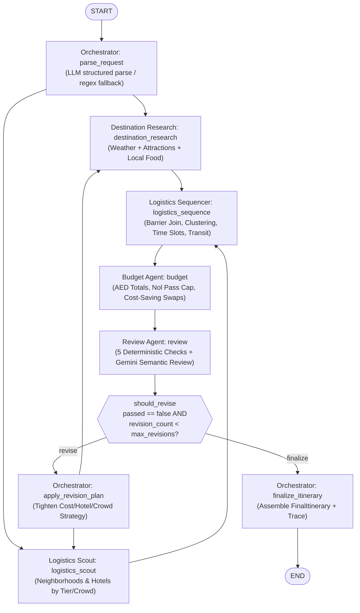

# Dubai AI Travel Planner (LangGraph Multi-Agent System)

**Live Application:** [Open Dubai AI Travel Planner on Streamlit](https://multi-agent-rtyfkferm7sdyvte9q3syt.streamlit.app/) — `https://multi-agent-rtyfkferm7sdyvte9q3syt.streamlit.app/`

A stateful, fault-tolerant **multi-agent AI travel planner for Dubai (1–7 days, AED budgets)** built with **LangGraph**, **LangChain**, **Pydantic v2**, and **Streamlit**.

Five specialized agents collaborate across parallel fan-out branches, barrier joins, deterministic domain validation, and bounded revision loops—backed by a **3-tier offline-first data layer** (free open APIs → SQLite TTL cache → curated Dubai dataset) and a **dual-LLM architecture** (**Groq `openai/gpt-oss-120b`** for planning + **Google Gemini `gemini-3.8-flash`** for review) that can also run end-to-end in zero-key deterministic mode.

---

## Key Capabilities

- **Parallel Multi-Agent Orchestration:** `destination_research` and `logistics_scout` execute concurrently after request parsing and synchronize at a barrier join before day-by-day sequencing.
- **Role-Based Dual-LLM Routing:** Planning/orchestration agents default to **Groq (`openai/gpt-oss-120b`)**, while the **Review Agent** defaults to **Google Gemini (`gemini-3.8-flash`)** for independent itinerary verification.
- **Zero-Key & Offline Resilience:** Works cleanly with no paid travel API keys—and even with no LLM keys—by falling back to deterministic NLP prompt parsing, rule-based validation, and `data/dubai_curated.json`.
- **Dubai Domain Intelligence:**
  - **RTA Transit & Fare Modeling:** Zone-crossing Silver Nol card fares (AED 3 / 5 / 7.5), automatic **AED 20 1-day Nol pass cap**, and Dubai taxi meter heuristics (AED 5.00 base + AED 2.19/km, AED 12.00 minimum).
  - **Weather-Aware Scheduling:** Pulls 16-day forecasts from Open-Meteo or seasonal monthly climate bands, prioritizing indoor/mixed venues at midday and shifting outdoor stops to mornings or post-16:30 during hot periods (`>= 36°C`).
  - **Strict Provenance Tracking:** Every place, hotel, weather advisory, transit segment, and budget figure carries a `Provenance` record (`verified_dataset`, `api_derived`, or `estimated`).
- **Automated Revision Loop (`max_revisions = 2`):** When deterministic rules catch budget overruns or preference mismatches, the Orchestrator emits targeted cost caps and crowd filters and re-runs research, logistics, and budgeting automatically—producing a side-by-side **Draft 1 vs. Revised Diff**.

---

## Technology Stack

| Layer | Technologies | Purpose |
| :--- | :--- | :--- |
| **Orchestration** | `langgraph>=0.2.0` (`StateGraph`) | Stateful graph execution, parallel fan-out/join, conditional revision loop, streaming updates |
| **LLM Integration** | `langchain>=0.3.0`, `langchain-groq`, `langchain-google-genai`, `langchain-openai` | Provider-agnostic `init_chat_model` factory & structured Pydantic output (`with_structured_output`) |
| **Planning LLM (Default)** | Groq — `openai/gpt-oss-120b` (`temp=0.2`) | Request parsing (`parse_request`) for Orchestrator / Research / Logistics / Budget stack |
| **Review LLM (Default)** | Google Gemini — `gemini-3.8-flash` (`temp=0.1`) | Independent semantic coherence & interest-alignment check in `review` |
| **Validation & Schemas** | `pydantic>=2.0,<3.0` | Strictly typed state models (`TravelRequest`, `DayPlan`, `BudgetBreakdown`, `ReviewResult`, `FinalItinerary`) |
| **External Open APIs** | `httpx>=0.27.0` + OpenStreetMap Overpass, OSRM, Open-Meteo | Live Dubai POIs/restaurants, point-to-point route distances/durations, and 16-day weather forecasts |
| **Local Cache & Dataset** | Python `sqlite3` (`data/cache.db`) + `data/dubai_curated.json` | TTL-indexed API cache and verified baseline Dubai dataset |
| **Frontend & Observability** | `streamlit>=1.38.0` | Live step streaming, structured itinerary view, Draft-vs-Final cost diff, execution timeline |
| **Configuration & Tests** | `python-dotenv`, `pytest>=8.0.0`, Python 3.11+ (3.12 recommended) | `.env` / `st.secrets` loading and 35 automated unit, graph, fallback, and E2E tests |

---

## Multi-Agent Architecture

### Workflow Graph (`StateGraph`)

Defined in [src/dubai_planner/graph/workflow.py](src/dubai_planner/graph/workflow.py), the graph coordinates 8 nodes across 5 logical agents:



### Agent Roster & Responsibilities

| Agent | Graph Node(s) | LLM / Engine | Primary Inputs | State Outputs |
| :--- | :--- | :--- | :--- | :--- |
| **1. Orchestrator** | `parse_request`<br/>`apply_revision_plan`<br/>`finalize_itinerary` | Groq (`openai/gpt-oss-120b`) + deterministic parser & state machine | `user_prompt`, `review_result`, `draft_snapshots` | `travel_request`, `revision_strategy`, `revision_count`, `final_itinerary` |
| **2. Destination Research** | `destination_research` | `DataService` (`WeatherClient`, `PlacesClient`) | `travel_request`, `revision_strategy` | `weather_summary`, `candidate_places`, `candidate_restaurants` |
| **3. Logistics** | `logistics_scout`<br/>`logistics_sequence` | `DataService` (`HotelsClient`, `RoutesClient`, `haversine_km`) | `travel_request`, weather, places, restaurants, `revision_strategy` | `accommodation_options`, `selected_accommodation`, `day_plans` |
| **4. Budget** | `budget` | Tool helpers (`_estimate_trip_budget_impl`, `_find_budget_alternatives_impl`) + RTA day-pass cap | `selected_accommodation`, `day_plans`, `travel_request` | `budget_breakdown`, `draft_snapshots` |
| **5. Review** | `review` | `ItineraryValidator` (5 rule checks) + Gemini (`gemini-3.8-flash`) semantic check | `travel_request`, `day_plans`, `budget_breakdown`, `selected_accommodation` | `review_result`, `review_history`, `revision_instructions` |

### Shared State & Parallel Reducers

All nodes read from and write partial updates to `TravelPlannerState` ([src/dubai_planner/graph/state.py](src/dubai_planner/graph/state.py)). Because `destination_research` and `logistics_scout` execute in parallel and loop across revisions, custom reducers prevent lost updates:

- `candidate_places`, `candidate_restaurants`: merged by unique `id` via `_merge_places` (newest revision candidates placed first).
- `accommodation_options`: merged by `id` / lowercase name via `_merge_accommodations`.
- `review_history`, `draft_snapshots`, `execution_trace`: append-only reducers via `operator.add`.

---

## How Calls & Execution Flow Happen

### 1. Entry Point & Runtime Resolution (`runner.py`)
1. The UI calls `stream_planner(prompt, settings=..., use_llm=..., max_revisions=...)` (or programmatic callers use `run_planner(...)`) in [src/dubai_planner/runner.py](src/dubai_planner/runner.py).
2. `_resolve_runtime()` initializes:
   - `DataService.from_settings(cfg)` — loads `data/dubai_curated.json` and opens `data/cache.db`.
   - Primary `BaseChatModel` via `get_chat_model(cfg)` if primary credentials (`GROQ_API_KEY`, etc.) are present and `use_llm=True`.
   - Review `BaseChatModel` via `get_review_chat_model(cfg)` if review credentials (`GOOGLE_API_KEY`, etc.) are present and `use_llm=True`.
3. `build_planner_graph(...)` compiles the `StateGraph` and streams node-by-node state updates (`stream_mode="updates"`).

### 2. Node-by-Node Execution Walkthrough
1. **Request Parsing (`parse_request`):**
   - If the primary LLM (Groq `openai/gpt-oss-120b`) is configured, it invokes `llm.with_structured_output(TravelRequest)` to extract `duration_days` (`1..7`), `budget_aed`, `interests`, `hotel_preference`, `crowd_preference`, `travelers`, and optional `travel_dates`.
   - If no LLM key is configured or parsing raises an exception, `_parse_prompt_deterministically()` extracts the exact same `TravelRequest` schema using regex and keyword rules.
2. **Parallel Fan-Out (`destination_research` || `logistics_scout`):**
   - **`destination_research`:** Fetches Dubai weather via Open-Meteo (or seasonal band), queries attractions/beaches and local restaurants via `DataService`, filters by crowd preference and revision cost caps, and sorts indoor/mixed places first when `weather.is_hot_season` is true.
   - **`logistics_scout`:** Queries `HotelsClient` for accommodations matching `hotel_preference` (or `"budget"` when `prefer_cheapest_hotel` is active in a revision), preferred heritage/coastal areas (`al_fahidi`, `bur_dubai`, `deira`, plus `jumeirah` for beach trips), and `crowd_preference`.
3. **Barrier Join & Day Sequencing (`logistics_sequence`):**
   - Waits until **both** `destination_research` and `logistics_scout` complete.
   - Selects the top eligible hotel (cheapest first during budget revisions).
   - Seeds attractions to ensure **every requested interest** is covered across the trip, then clusters nearby secondary attractions and lunch/dinner restaurants using `haversine_km` and matching area.
   - Orders each day's stops (`Primary Attraction -> Lunch -> Secondary Attraction -> Dinner`), shifting afternoon outdoor activities to `16:30+` in hot weather and starting days earlier (`09:00` vs `09:30`).
   - Calls `DataService.get_route(...)` between consecutive stops to attach a `TransitSegment` (`walk`, `metro`, `tram`, `bus`, `taxi`, or `abra`) and computes chronological start/end times (`end_time + transit.duration_mins + buffer`).
4. **Budget Calculation (`budget`):**
   - Sums hotel nightly cost (`nightly_rate_aed * max(1, duration_days - 1)`), attraction tickets, meal estimates (defaulting to AED 120/day if meal stops are absent), and per-day transit fares using `calculate_daily_transit_cost()` (which caps combined `metro`/`bus`/`tram` fares at the **AED 20/day Silver Nol 1-day pass** when cheaper).
   - If `total_aed > budget_aed`, calls `_find_budget_alternatives_impl()` to compute concrete savings from hotel downgrades and free/low-cost attraction swaps.
   - Records a budget snapshot into `draft_snapshots` for Draft-vs-Final comparison.
5. **Validation & Review (`review`):**
   - Runs `ItineraryValidator.validate()` ([src/dubai_planner/validation/rules.py](src/dubai_planner/validation/rules.py)) across **5 deterministic rule categories**:
     1. **Budget (`budget_exceeded`):** Category sum matches `total_aed` (±AED 0.50 tolerance) and `total_aed <= request.budget_aed`.
     2. **Duration (`missing_info`):** Exact `len(days) == duration_days`, sequential day numbers `1..N`, and accommodation present.
     3. **Duplicates (`duplicate_poi`):** No repeated attraction or restaurant across the trip.
     4. **Schedule Feasibility (`timing_overlap`, `unrealistic_transit`, `missing_info`):** At least 2 stops/day, valid `start_time < end_time`, no overlapping slots, transit buffer respected (`next.start >= prev.end + transit_duration`), and valid transit duration/distance.
     5. **Preferences (`preference_mismatch`):** Respects `crowd_preference == "low"` (flags `"high"` crowd stops/hotels) and verifies requested interests appear across scheduled activities.
   - When deterministic checks pass **and** `review_llm` (Gemini `gemini-3.8-flash`) is configured, `review` invokes `review_llm` with the day-by-day summary and user interests/crowd preference to append a concise semantic verification note (`PASS` / `NOTE`).
6. **Bounded Revision Loop (`should_revise` -> `apply_revision_plan`):**
   - If `review_result.passed` is `False` and `revision_count < max_revisions` (default `2`):
     - `apply_revision_plan` increments `revision_count` and updates `revision_strategy`:
       - On **`budget_exceeded`**: sets `prefer_cheapest_hotel = True`, `prefer_low_cost_places = True`; Revision 1 caps attractions at `AED 15` and meals at `AED 45`; Revision 2 tightens caps to `AED 0` (free attractions) and `AED 35` meals.
       - On **`preference_mismatch`** (or `low` crowd preference): sets `exclude_high_crowd = True`.
     - Routes back in parallel to `destination_research` and `logistics_scout` to regenerate an improved plan.
   - Otherwise routes to `finalize_itinerary`, which calculates any Draft 1 vs. Final savings diff, packages the `ExecutionTrace`, and returns `FinalItinerary`.

---

## 3-Tier Data & Caching Flow

Every external lookup in [src/dubai_planner/data/provider.py](src/dubai_planner/data/provider.py) follows a deterministic **Cache -> Live Open API -> Curated Fallback** strategy so the app stays fast and never crashes if an external API times out or `OFFLINE_MODE=true` is enabled:

```
Agent / Tool Request
   │
   ▼
[1] SQLiteCache (data/cache.db) ── Cache Hit (unexpired TTL) ──▶ Return cached payload
   │ Cache Miss / Expired
   ▼
[2] Free Open API (skipped if OFFLINE_MODE=true)
    • Overpass API (overpass-api.de)      — Dubai POIs & restaurants   | TTL: 24h (86,400s)
    • OSRM (router.project-osrm.org)      — Route distance & duration  | TTL: 7d  (604,800s)
    • Open-Meteo (api.open-meteo.com)     — 16-day forecast (<=16d)    | TTL: 6h  (21,600s)
   │ Timeout / Network Error / Unavailable
   ▼
[3] Local Verified Baseline (data/dubai_curated.json + Haversine fallback)
    • 7 Dubai neighborhoods (with RTA zone & coordinates)
    • 22 attractions & beaches | 17 local restaurants | 10 hotels (budget / mid_range / luxury)
    • 12 monthly seasonal climate bands | RTA Silver Nol, 1-day pass & taxi fare tables
```

---

## Streamlit UI & Observability

[app.py](app.py) wraps the compiled LangGraph workflow in an interactive workspace featuring:

- **Sidebar Controls:**
  - `Offline Mode` toggle (forces 100% curated local data + Haversine transit without external HTTP calls).
  - `Use Configured Chat LLMs` toggle (displays active primary and review models; automatically switches to zero-key mode when no API keys are present).
  - `Max Review Revisions` slider (`0–3`, default `2`).
- **Quick-Load Example Prompts:**
  - *4-Day Cultural & Beach (AED 5,000)*
  - *Tight-Budget Revision Demo (AED 1,800)* — showcases automatic budget-overrun detection and revision savings
  - *Summer Heat-Aware Trip (July, 3 Days)* — showcases indoor midday prioritization
- **3 Result Tabs:**
  1. **Structured Itinerary:** Trip metrics, recommended hotel, itemized AED budget table, cost-saving alternatives, day-by-day schedule, RTA transit legs, and provenance badges.
  2. **Revision Diff:** Violations caught on Draft 1, revision instructions issued, and a Draft 1 vs. Revised cost/hotel comparison table with AED savings.
  3. **Agent Execution Timeline:** Chronological log of every LangGraph node execution with agent role, revision badge, latency (`ms`), tools called, and step summary.

---

## Project Structure

```text
Multi-Agent/
├── app.py                              # Streamlit UI, secrets sync & live LangGraph streaming
├── requirements.txt                    # Runtime dependencies for Streamlit Community Cloud
├── pyproject.toml                      # Package metadata & pytest configuration
├── .env.example                        # Template for Groq, Gemini, and workflow env vars
├── data/
│   └── dubai_curated.json              # Offline-first Dubai neighborhoods, POIs, hotels, RTA & weather data
├── src/dubai_planner/
│   ├── config.py                       # Settings loader & role-based chat LLM factories
│   ├── runner.py                       # run_planner() & stream_planner() entry points
│   ├── models/
│   │   ├── schemas.py                  # Pydantic v2 domain schemas & Provenance models
│   │   └── trace.py                    # AgentEvent & ExecutionTrace models
│   ├── data/
│   │   ├── cache.py                    # Thread-safe SQLite TTL response cache
│   │   ├── curated.py                  # CuratedDataset loader & haversine_km helper
│   │   ├── hotels_client.py            # Curated hotel search by tier, rate & crowd level
│   │   ├── places_client.py            # Overpass API client + cache + curated POI/food fallback
│   │   ├── routes_client.py            # OSRM routing + RTA Nol / 1-day pass / taxi fare math
│   │   ├── weather_client.py           # Open-Meteo 16-day client + seasonal band fallback
│   │   └── provider.py                 # Unified DataService facade
│   ├── tools/
│   │   └── agent_tools.py              # LangChain @tool wrappers & budget calculation helpers
│   ├── validation/
│   │   └── rules.py                    # ItineraryValidator (5 deterministic rule categories)
│   └── graph/
│       ├── state.py                    # TravelPlannerState TypedDict & parallel merge reducers
│       ├── nodes.py                    # PlannerNodes (all 8 LangGraph node implementations)
│       └── workflow.py                 # StateGraph wiring, should_revise router & compilation
├── tests/
│   ├── test_phase1_schemas.py          # Config & Pydantic schema tests
│   ├── test_data_fallback.py           # Cache, API fallback, RTA fare & seasonal weather tests
│   ├── test_validation.py              # Deterministic validator rule tests
│   ├── test_graph_workflow.py          # Parallel graph execution & revision loop tests
│   └── test_e2e_mvp.py                 # End-to-end prompt, budget revision & trace tests
├── architecture.md                     # Detailed design specification
├── implementation-plan.md              # Phased build checklist
├── problemStatement.md                 # MVP scope & acceptance criteria
└── research.md                         # Dubai data source, transit & climate research
```
