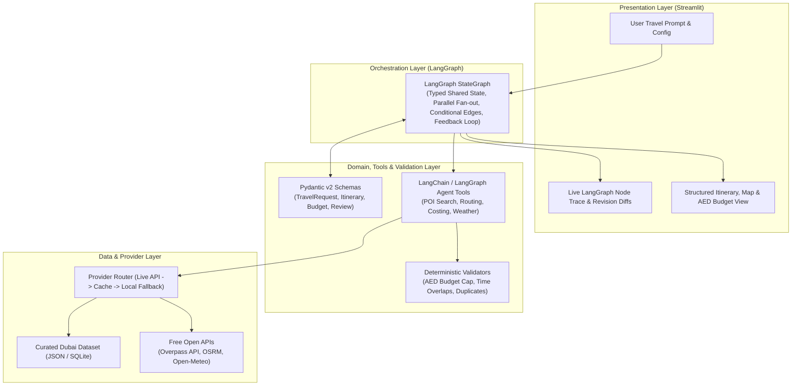
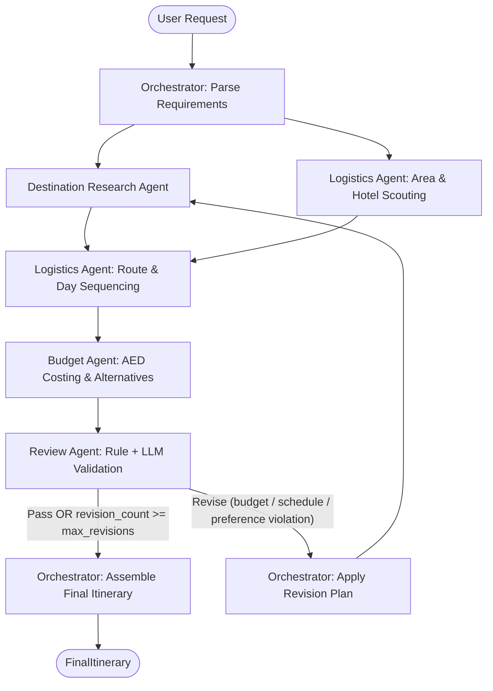

# Architecture — Dubai AI Travel Planner (Multi-Agent System)

This document defines the system architecture for the **Dubai AI Travel Planner**, based on [problemStatement.md](file:///Users/mna/Downloads/Multi-Agent/problemStatement.md). The system is orchestrated using **LangGraph** as a stateful multi-agent workflow built on top of shared Pydantic domain models, unified tools, a fallback-resilient data layer, and deterministic validators.

---

## 1. Architectural Principles

1. **Clean Separation of Concerns:** Domain schemas (Pydantic), data providers, cost calculators, and deterministic validators are decoupled from the LangGraph orchestration nodes for testability and clarity.
2. **Strict Data Provenance:** Every recommendation, route duration, and AED cost carries a provenance tag (`verified_dataset`, `api_derived`, or `estimated`) so the UI and Review Agent can distinguish facts from estimates.
3. **Offline-First with Free Open API Enhancement:** The system runs reliably using a curated local Dubai JSON/SQLite dataset and enhances results with free, no-key open APIs (OpenStreetMap Overpass, OSRM, Open-Meteo) when connectivity is available.
4. **Observable State Transitions & Revision Tracking:** Each LangGraph node emits standardized `AgentEvent` records (node name, inputs, outputs, latency, and revision diffs) so the Streamlit UI can visualize agent collaboration and state changes in real time.
5. **Bounded Feedback Loops:** Review-triggered revisions are capped (e.g., `max_revisions = 2`) to prevent infinite loops while guaranteeing at least one observable constraint-detection and revision cycle when violations occur.

---

## 2. High-Level System Architecture



---

## 3. Core Data Models (Shared Pydantic Schemas)

All LangGraph nodes read from and write to typed Pydantic v2 structures inside the shared graph state so intermediate and final outputs are strictly validated.

| Model | Key Fields | Purpose |
| :--- | :--- | :--- |
| `TravelRequest` | `destination` (`"Dubai"`), `duration_days` (`1..7`), `budget_aed`, `excludes_flights`, `interests`, `hotel_preference`, `crowd_preference`, `travel_dates` (optional) | Parsed structured constraints extracted by the Orchestrator. |
| `Provenance` | `source_type` (`verified_dataset \| api_derived \| estimated`), `source_name`, `retrieved_at` | Tracks where each fact, duration, or price came from. |
| `PlaceCandidate` | `id`, `name`, `category` (`attraction \| restaurant \| beach \| neighborhood`), `area`, `lat`, `lon`, `crowd_level`, `estimated_cost_aed`, `duration_mins`, `provenance` | Candidate POIs returned by the Destination Research Agent. |
| `AccommodationOption` | `name`, `area`, `tier` (`budget \| mid_range \| luxury`), `nightly_rate_aed`, `metro_access`, `crowd_level`, `provenance` | Hotel/area suggestions from Logistics & Budget Agents. |
| `TransitSegment` | `from_place`, `to_place`, `mode` (`metro \| bus \| tram \| taxi \| walk`), `duration_mins`, `distance_km`, `estimated_fare_aed`, `provenance` | Point-to-point logistics and RTA/taxi estimates. |
| `DayPlan` | `day_number`, `theme`, `area_focus`, `activities` (ordered list with `start_time`, `end_time`, `place`, `transit_to_next`), `weather_note` | Daily schedule assembled by Logistics/Orchestrator. |
| `BudgetBreakdown` | `accommodation_aed`, `food_aed`, `transportation_aed`, `activities_aed`, `total_aed`, `remaining_aed`, `over_budget`, `alternatives` | Category-wise AED breakdown and cheaper swap suggestions. |
| `ReviewResult` | `passed` (`bool`), `violations` (list of typed issues: `budget_exceeded`, `schedule_conflict`, `preference_mismatch`, `duplicate_activity`, `missing_info`), `revision_instructions` | Output of the Review Agent driving pass/revise routing. |
| `FinalItinerary` | `request`, `accommodation`, `days`, `budget`, `review_history`, `execution_trace` | Unified final output rendered by Streamlit. |

---

## 4. Multi-Agent Design & Responsibilities

### Agent 1 — Orchestrator Agent
- **Role:** Parses the natural-language user prompt into `TravelRequest`, dispatches work to specialized agents, manages dependencies, and assembles `FinalItinerary`.
- **Inputs:** Raw user prompt (e.g., *"Plan a 4-day trip to Dubai with a budget of AED 5,000..."*).
- **Outputs:** `TravelRequest` (initial), `FinalItinerary` (final synthesis).
- **Failure / Edge Handling:** Normalizes missing fields with safe defaults (e.g., defaults `duration_days` or flags missing dates for seasonal weather fallback).

### Agent 2 — Destination Research Agent
- **Role:** Discovers Dubai attractions, local restaurants, cultural experiences, and beaches aligned with user interests and crowd preferences.
- **Tools:** `search_attractions`, `search_restaurants`, `get_weather_forecast`.
- **Inputs:** `TravelRequest` (+ `ReviewResult.revision_instructions` on revise loops).
- **Outputs:** Ranked list of `PlaceCandidate` items grouped by neighborhood, avoiding high-crowd venues when `crowd_preference == "low"`.

### Agent 3 — Logistics Agent
- **Role:** Selects suitable accommodation areas, clusters activities geographically to minimize cross-city backtracking, computes travel times, and recommends RTA/taxi transit options.
- **Tools:** `get_accommodation_options`, `get_route_and_transit`.
- **Inputs:** `TravelRequest`, `PlaceCandidate[]` (or runs in parallel with Destination Agent on initial area/hotel scouting, then sequences selected POIs).
- **Outputs:** `AccommodationOption[]`, `DayPlan[]` with `TransitSegment[]`.

### Agent 4 — Budget Agent
- **Role:** Calculates category-wise AED costs (accommodation, food, RTA/taxi transit, attraction tickets), checks total against `budget_aed`, and proposes concrete lower-cost alternatives when over budget.
- **Tools:** `estimate_trip_budget`, `find_budget_alternatives`.
- **Inputs:** `TravelRequest`, `AccommodationOption`, `DayPlan[]`.
- **Outputs:** `BudgetBreakdown` (including `alternatives` list if `over_budget == True`).

### Agent 5 — Review Agent
- **Role:** Audits the complete draft itinerary using both **deterministic rule checks** and **LLM semantic review** for:
  1. Budget compliance (`total_aed <= budget_aed`).
  2. Schedule feasibility (realistic opening hours, no overlapping times, reasonable daily transit time).
  3. Preference alignment (cultural/local food/beaches present; crowded tourist traps avoided if requested).
  4. Duplicate activities across days.
  5. Missing required sections (accommodation, transit, or category costs).
- **Outputs:** `ReviewResult` (`passed: True/False` + actionable `revision_instructions`).

---

## 5. LangGraph Orchestration Architecture

LangGraph models the multi-agent workflow as a `StateGraph` over a shared `TravelPlannerState` (`TypedDict` with reducers for parallel branch merging and trace appending).



**Key LangGraph Mechanics:**
- **Parallel Execution:** `PARSE` fans out to `Destination Research Agent` and `Logistics Area/Hotel Scouting` concurrently, merging results via state reducers before `Logistics Sequencing`.
- **Shared State (`TravelPlannerState`):** Holds `user_prompt`, `travel_request`, `candidate_places`, `accommodation_options`, `day_plans`, `budget_breakdown`, `review_result`, `revision_count`, `max_revisions`, and `execution_trace`.
- **Conditional Routing:** `should_revise(state)` inspects `state["review_result"].passed` and `state["revision_count"] < state["max_revisions"]`.
- **Feedback Loop:** On `Revise`, `revision_instructions` are written to shared state, `revision_count` increments, and the graph routes back to adjust destinations/accommodation/budget.
- **Streaming to UI:** Uses LangGraph's `stream()` / `astream_events()` to push node-by-node progress updates directly to Streamlit.

---

## 6. Tool & Data Provider Layer

Every agent tool calls a unified `DataService` that resolves requests through a deterministic 3-step chain:

1. **Free Open API** (Overpass, OSRM, Open-Meteo — when online and cache misses).
2. **Local Cache** (SQLite/file cache with TTL to respect fair-use limits and reduce latency).
3. **Curated Local Dataset Fallback** (`data/dubai_curated.json` / `data/dubai.db`).

```text
Agent Tool Call
      │
      ▼
DataService Router
  ├── [Online & Cache Miss] ──► Free Open API ──► Cache & Tag (api_derived)
  └── [Offline / Error]     ──► Curated Local DB ──► Tag (verified_dataset / estimated)
```

*(See [research.md](file:///Users/mna/Downloads/Multi-Agent/research.md) for full details on every external API, open dataset, RTA fare rule, and fallback heuristic.)*

---

## 7. Deterministic Validation Layer

To ensure the Review Agent does not rely solely on LLM judgment for math or constraints, a Python `ItineraryValidator` runs deterministic checks before/alongside the LLM review:

- **Budget Check:** `sum(category_costs) == total_aed` and `total_aed <= request.budget_aed`.
- **Duration Check:** `len(itinerary.days) == request.duration_days`.
- **Duplicate Check:** No attraction/restaurant ID appears more than once across the itinerary.
- **Time Feasibility Check:** Activities within each day are chronologically ordered, non-overlapping, and include transit buffers (`transit_duration_mins > 0` between distinct locations).
- **Preference Check:** Verifies requested interest tags (e.g., `cultural`, `local_food`, `beach`) are represented and flags `crowd_level == "high"` if `crowd_preference == "low"`.

---

## 8. Suggested Project Directory Structure

```text
Multi-Agent/
├── app.py                          # Streamlit interactive UI (live trace viewer, revision diffs, itinerary)
├── pyproject.toml                  # Dependencies (langgraph, langchain, pydantic, streamlit, httpx, etc.)
├── .env.example                    # Configurable LLM & optional API keys
├── problemStatement.md             # Project scope and requirements
├── architecture.md                 # System architecture (this file)
├── research.md                     # Data sources, APIs, and fallback research
├── data/
│   ├── dubai_curated.json          # Curated attractions, restaurants, hotels, RTA fares, seasonal weather
│   └── cache.db                    # SQLite cache for API responses
├── src/
│   └── dubai_planner/
│       ├── config.py               # Settings, LLM provider factory, API key detection
│       ├── models/
│       │   ├── schemas.py          # Shared Pydantic v2 models
│       │   └── trace.py            # ExecutionTrace & AgentEvent models
│       ├── data/
│       │   ├── provider.py         # DataService router (Free Open API -> Cache -> Local fallback)
│       │   ├── places_client.py    # Overpass API & curated local POI/restaurant client
│       │   ├── routes_client.py    # OSRM / Haversine routing & RTA fare calculator
│       │   ├── hotels_client.py    # Curated Dubai hotel & area dataset client
│       │   └── weather_client.py   # Open-Meteo & seasonal fallback
│       ├── tools/
│       │   └── agent_tools.py      # LangGraph/LangChain tool wrappers
│       ├── validation/
│       │   └── rules.py            # Deterministic budget, schedule, duplicate, and preference checks
│       ├── graph/
│       │   ├── state.py            # TravelPlannerState TypedDict & reducers
│       │   ├── nodes.py            # Node implementations for all 5 agents
│       │   └── workflow.py         # LangGraph StateGraph assembly & conditional edges
│       └── runner.py               # Unified entry point: run_planner(prompt)
└── tests/
    ├── test_validation.py          # Unit tests for deterministic AED budget & schedule rules
    ├── test_data_fallback.py       # Offline fallback & provenance tagging tests
    └── test_graph_workflow.py      # End-to-end LangGraph execution & revision loop tests
```

---

## 9. Observability & Streamlit Visualization View

To satisfy the MVP requirement of visualizing multi-agent execution and revision loops:

- **Execution Timeline:** Displays each `AgentEvent` (`agent_name`, `step_type`, `duration_ms`, `tools_called`, `summary`) streamed from LangGraph nodes.
- **Graph State & Revision Diff Panel:** Highlights what changed between Draft 1 and the Revised Itinerary (e.g., *"Review Agent detected AED 5,420 > AED 5,000 limit; Budget Agent swapped Marina hotel for Al Fahidi boutique hotel, saving AED 600"*).
- **Itinerary & Budget View:** Renders the day-by-day schedule, transit segments, AED category breakdown, and provenance badges (`verified_dataset`, `api_derived`, `estimated`).
