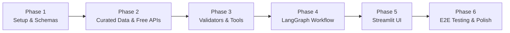

# Implementation Plan — Dubai AI Travel Planner (LangGraph)

This document outlines a phase-wise implementation plan for building the **Dubai AI Travel Planner**, derived from [problemStatement.md](file:///Users/mna/Downloads/Multi-Agent/problemStatement.md), [architecture.md](file:///Users/mna/Downloads/Multi-Agent/architecture.md), and [research.md](file:///Users/mna/Downloads/Multi-Agent/research.md).

Each phase produces working, testable deliverables before moving to the next layer.

---

## Roadmap Overview

---

## Phase 1: Project Setup, Configuration & Core Schemas

**Objective:** Establish the Python project skeleton, configurable LLM provider, and shared Pydantic v2 data contracts.

### Tasks
1. Initialize project dependencies in `pyproject.toml` (`langgraph`, `langchain`, `pydantic>=2`, `streamlit`, `httpx`, `python-dotenv`, `pytest`).
2. Create `.env.example` for configurable LLM provider settings (`LLM_PROVIDER`, `LLM_MODEL`, provider API key) without any paid travel API keys.
3. Implement `src/dubai_planner/config.py` to load environment settings and instantiate the configured chat LLM.
4. Implement `src/dubai_planner/models/schemas.py` with all core Pydantic v2 models:
   - `TravelRequest` (1–7 days, AED budget, interests, hotel & crowd preferences, optional dates)
   - `Provenance` (`verified_dataset` | `api_derived` | `estimated`)
   - `PlaceCandidate`, `AccommodationOption`, `TransitSegment`, `DayPlan`, `BudgetBreakdown`, `ReviewResult`, `FinalItinerary`
5. Implement `src/dubai_planner/models/trace.py` (`AgentEvent`, `ExecutionTrace`) for observability.

### Deliverables
- `pyproject.toml`, `.env.example`, `src/dubai_planner/config.py`
- `src/dubai_planner/models/schemas.py`, `src/dubai_planner/models/trace.py`

### Exit Criteria
- Package installs cleanly in the virtual environment.
- Sample `TravelRequest` and `FinalItinerary` payloads serialize/deserialize without validation errors.

---

## Phase 2: Curated Dubai Dataset & Free Data Access Layer

**Objective:** Build the offline-first curated Dubai dataset and free, no-key open API clients with SQLite caching and strict provenance tagging.

### Tasks
1. Create `data/dubai_curated.json` covering:
   - **Neighborhoods:** Al Fahidi, Bur Dubai, Deira, Al Barsha, Jumeirah, Downtown, Dubai Marina (with `crowd_level` and metro lines).
   - **Attractions & Beaches:** Cultural/heritage sites, museums, parks, public beaches with published AED ticket prices and `last_verified` dates.
   - **Local Restaurants:** Authentic Emirati/local spots with curated AED meal ranges.
   - **Hotels:** Budget and mid-range options grouped by area with nightly AED ranges and metro walk times.
   - **RTA Fares & Seasonal Weather:** Official 7-zone Nol card rates (AED 3.00 / 5.00 / 7.50, AED 20 1-day pass), taxi meter heuristics, and monthly Dubai climate bands.
2. Implement SQLite response caching (`data/cache.db`) with TTL support.
3. Implement data clients in `src/dubai_planner/data/`:
   - `places_client.py`: Overpass API (`overpass-api.de/api/interpreter`) + curated local fallback.
   - `routes_client.py`: OSRM (`router.project-osrm.org`) + Haversine/speed fallback + RTA Nol fare calculator.
   - `hotels_client.py`: Curated hotel & area lookup filtered by tier, budget, and crowd preference.
   - `weather_client.py`: Open-Meteo (`api.open-meteo.com/v1/forecast`) for trips ≤16 days + monthly seasonal fallback.
   - `provider.py`: `DataService` router (`Free Open API -> SQLite Cache -> Curated Local DB`).
4. Write `tests/test_data_fallback.py` to test offline mode, cache hits, and provenance tags.

### Deliverables
- `data/dubai_curated.json`
- `src/dubai_planner/data/{provider,places_client,routes_client,hotels_client,weather_client}.py`
- `tests/test_data_fallback.py`

### Exit Criteria
- All data lookups succeed with network disabled (100% fallback to `dubai_curated.json`).
- Every returned record includes accurate `Provenance` metadata.

---

## Phase 3: Deterministic Validation & LangGraph Tools

**Objective:** Implement rule-based itinerary/budget validators and wrap the `DataService` capabilities as LangGraph/LangChain tools.

### Tasks
1. Implement `src/dubai_planner/validation/rules.py` (`ItineraryValidator`) with deterministic checks:
   - **Budget Check:** Category sum matches `total_aed` and `total_aed <= request.budget_aed`.
   - **Duration Check:** `len(days) == request.duration_days` (within 1–7 days).
   - **Duplicate Check:** No repeated attraction or restaurant IDs across the itinerary.
   - **Schedule Feasibility:** Chronological non-overlapping time slots with positive transit buffers between distinct locations.
   - **Preference Alignment:** Requested interests (cultural, local food, beaches) are present; high-crowd venues flagged when `crowd_preference == "low"`.
2. Implement `src/dubai_planner/tools/agent_tools.py` exposing `@tool` functions:
   - `search_attractions`, `search_restaurants`, `get_accommodation_options`, `get_route_and_transit`, `estimate_trip_budget`, `find_budget_alternatives`, `get_weather_forecast`.
3. Write `tests/test_validation.py` covering passing itineraries and intentional violations (over-budget, duplicate POI, overlapping times, crowd mismatch).

### Deliverables
- `src/dubai_planner/validation/rules.py`
- `src/dubai_planner/tools/agent_tools.py`
- `tests/test_validation.py`

### Exit Criteria
- `pytest tests/test_validation.py` passes with 100% coverage of all 5 validation rule categories.

---

## Phase 4: LangGraph Multi-Agent Workflow & Feedback Loop

**Objective:** Implement the 5 specialized agents as nodes in a LangGraph `StateGraph` with parallel execution, shared state, and a bounded review-revision loop.

### Tasks
1. Define `TravelPlannerState` in `src/dubai_planner/graph/state.py` using `TypedDict` and `Annotated` reducers for parallel branch merging (`candidate_places`, `accommodation_options`, `execution_trace`).
2. Implement the 5 agent nodes in `src/dubai_planner/graph/nodes.py`:
   - **Orchestrator Node (`parse_request`, `apply_revision_plan`, `finalize_itinerary`):** Extracts `TravelRequest`, coordinates revisions, and assembles `FinalItinerary`.
   - **Destination Research Node:** Queries attractions, beaches, and local restaurants matching user interests and weather.
   - **Logistics Node (`scout_areas`, `sequence_days`):** Selects accommodation areas in parallel with destination research, then clusters POIs geographically with RTA/taxi transit segments.
   - **Budget Node:** Computes category-wise AED costs and generates concrete swap alternatives if `total_aed > budget_aed`.
   - **Review Node:** Runs `ItineraryValidator` + LLM semantic review to produce `ReviewResult` (`passed` + `revision_instructions`).
3. Assemble the graph in `src/dubai_planner/graph/workflow.py`:
   - Parallel fan-out from `parse_request` to `destination_research` and `logistics_scout`.
   - Conditional edge `should_revise(state)` routing to `apply_revision_plan` when `not review_result.passed and revision_count < max_revisions` (default `max_revisions = 2`), or to `finalize_itinerary`.
4. Create `src/dubai_planner/runner.py` (`run_planner(prompt)` + `stream_planner(prompt)`).
5. Write `tests/test_graph_workflow.py` verifying end-to-end execution and at least one triggered review-revision cycle.

### Deliverables
- `src/dubai_planner/graph/{state,nodes,workflow}.py`
- `src/dubai_planner/runner.py`
- `tests/test_graph_workflow.py`

### Exit Criteria
- Running the example prompt (*"Plan a 4-day trip to Dubai with a budget of AED 5,000..."*) produces a valid `FinalItinerary`.
- Tight-budget test case triggers `Review -> Revise -> Pass` and logs the state diff.

---

## Phase 5: Streamlit Interactive UI & Observability

**Objective:** Build an interactive Streamlit frontend that visualizes agent execution, state transitions, revision diffs, and the final Dubai itinerary.

### Tasks
1. Create `app.py` with:
   - **Input Panel:** Natural-language prompt box + quick-load example buttons (including the AED 5,000 4-day cultural/beach prompt and a tight-budget revision demo prompt).
   - **Live Execution Timeline:** Streams `AgentEvent` updates as each LangGraph node runs, showing active agent, tools called, and latency.
   - **Revision Diff Panel:** Displays Draft 1 vs. Revised Itinerary (e.g., detected violation, swapped hotel/activity, and AED savings).
   - **Structured Itinerary View:** Day-by-day schedule with timings, transit modes/durations, accommodation recommendation, category-wise AED budget breakdown, and provenance badges (`verified_dataset`, `api_derived`, `estimated`).

### Deliverables
- `app.py`

### Exit Criteria
- End-to-end interactive flow runs in Streamlit without errors and clearly visualizes parallel execution and review revisions.

---

## Phase 6: End-to-End Verification & MVP Sign-Off

**Objective:** Validate all MVP success criteria from [problemStatement.md](file:///Users/mna/Downloads/Multi-Agent/problemStatement.md) and finalize documentation.

### Tasks
1. Run the full test suite (`pytest`) covering data fallback, deterministic validators, and LangGraph workflow.
2. Verify edge cases:
   - Trip durations across **1–7 days**.
   - High-heat summer dates vs. mild winter dates (weather-aware activity adjustments).
   - Offline mode (no internet access) vs. online mode (Overpass + OSRM + Open-Meteo).
3. Verify all 5 MVP Success Criteria:
   - Natural-language input → structured Dubai `FinalItinerary`.
   - Meaningful collaboration across all 5 specialized agents.
   - Realistic schedules and AED budgets with provenance tags.
   - Detection and revision of at least one constraint violation.
   - Clear UI visualization of agent execution and review changes.

### Exit Criteria
- All `pytest` suites pass.
- Streamlit demo verified on the primary example prompt and a constraint-violation prompt.
